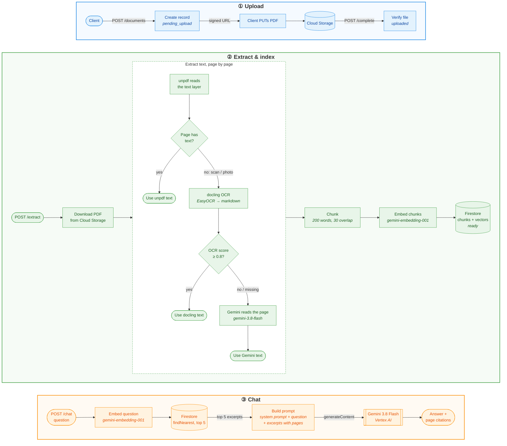

# Chat with PDF

Upload your PDF and chat with it!

Answers to your questions will be grounded in the document you have uploaded, with page citations!

Version 1 is an API only: no UI yet.

## Screenshot

## How this works?

## Tech Stack

|  |  |
  |---|---|
  | Runtime | Node.js 26 + Express 5 |
  | Embeddings | Vertex AI `gemini-embedding-001` (768 dimensions) |
  | Chat / answer generation | Vertex AI `gemini-3.8-flash` |
  | AI SDK | `@google/genai` |
  | Vector store | Firestore vector search (`findNearest`, cosine distance) |
  | PDF text extraction | [`unpdf`](https://github.com/unjs/unpdf) |
  | OCR for scanned pages | [docling-serve](https://github.com/docling-project/docling-serve) on Cloud Run, with EasyOCR |
  | OCR fallback | Vertex AI `gemini-3.8-flash`, for scanned pages docling's OCR scored below 0.8 |
  | PDF page splitting | [`pdf-lib`](https://github.com/Hopding/pdf-lib) |
  | File storage | GCP Cloud Storage |
  | Hosting | GCP Cloud Run |

## Roadmap

- Eval Harness
- Add new adapter for GCP "Vector Search"
- Pub/Sub based upload detection

## Documentation

- [Prerequisites](docs/prerequisites.md)
- [Run locally](docs/run-locally.md)
- [Testing](docs/testing.md)
- [Deploy](docs/deploy.md)
- [Deploy docling](docs/deploy-docling.md)
- [Data model](docs/data-model.md)
- [RAG](docs/rag.md)
- [API](docs/api.md)
